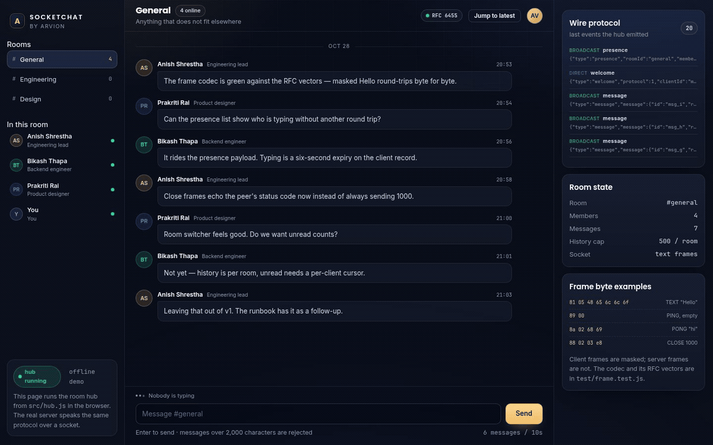
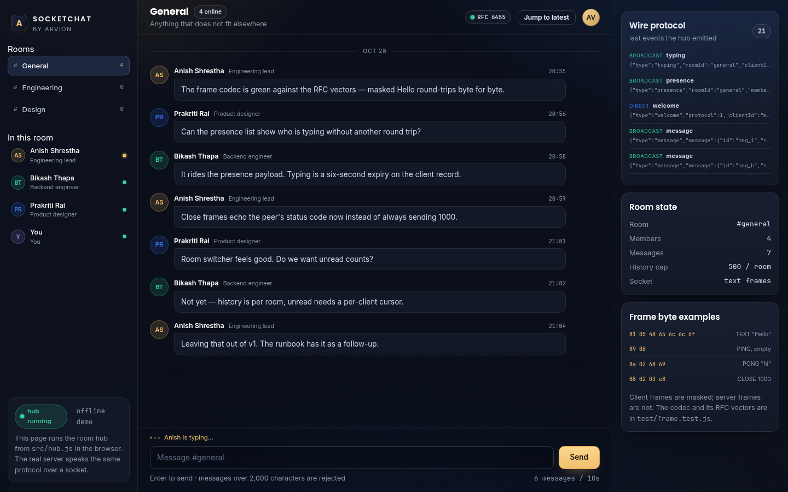

<div align="center">

</div>

<sub>Recorded from the live demo — <a href="docs/demo.mp4">MP4</a> · <a href="docs/screenshot.png">static frame</a></sub>

# SocketChat

A realtime chat server with rooms, presence, typing indicators and history. It
speaks RFC 6455 WebSockets implemented directly on `node:http` — handshake, frame
parser, masking, fragmentation, ping/pong and close — with no `ws` package and no
runtime dependency at all.

[**Open the live demo**](https://arvion-technology.github.io/labs/demos/socketchat/demo/) · [MIT](LICENSE)

---

There are two useful things to look at here. First, `src/frame.js` is a frame
codec tested against the RFC's own byte examples, including the masked `Hello`
frame, 16- and 64-bit length headers, interleaved control frames and close-code
validation. Second, `src/hub.js` is transport-free: the WebSocket server and the
browser demo both call the same room methods, so the demo is not a mock of the
server.

The static demo runs the hub in the browser with three simulated peers. `node
server.mjs` runs the real thing on a socket, and `node client.mjs` is a small
terminal client that exercises the handshake and framing without a browser.

## What it does

- **WebSocket server** — HTTP upgrade validation, `Sec-WebSocket-Accept` hash,
  frame decode/build, masking, fragmentation, ping/pong and the closing handshake
  on a raw `node:http` server.
- **Rooms** — general, engineering and design by default; join, leave and switch
  without losing per-room history.
- **Presence and typing** — presence is derived from the connected client records;
  typing is a six-second expiry, not a separate socket event stream.
- **History** — per-room, capped at 500 messages, paginated backwards by message
  id so a reconnect does not need the whole room.
- **Rate limiting** — six messages per ten seconds per client, with the remaining
  wait returned in the error.
- **Moderation hook** — a function called before a message is stored; return a
  reason to reject it.
- **Terminal client** — `client.mjs` joins a room, prints messages and sends what
  you type, using the same codec the server uses.

## Screenshots

| General room | Engineering room |
| --- | --- |
|  |  |

## Architecture

```
 browser demo                          node server.mjs
 ┌───────────────────┐                ┌────────────────────────────────┐
 │ demo/app.js       │                │ src/server.js                  │
 │  simulated peers ─┼──┐             │  http server + /ws upgrade     │
 │  composer         │  │             │  socket pump → decodeFrame     │
 └───────────────────┘  │             │  heartbeat, close handshake    │
                        ▼             └──────────────┬─────────────────┘
                ┌───────────────────┐                │ dispatch / events
                │ src/hub.js        │◄───────────────┘
                │  join/leave       │
                │  presence, typing │       ┌──────────────────────────┐
                │  history, limits  │       │ src/frame.js             │
                │  moderation hook  │       │  81 05 48 65 6c 6c 6f    │
                └───────────────────┘       │ src/handshake.js         │
                                            └──────────────────────────┘
```

The server binds a socket, parses frames into `ChatHub.dispatch(clientId, message)`
and routes the returned events: `direct` events go back to the sender, `broadcast`
events go to everyone in the room. The browser demo skips only the socket.

A protocol message in both directions is JSON in a text frame:

```json
{"type":"join","name":"Ada","userId":"u_ada","roomId":"general"}
{"type":"message","text":"the frame codec is green"}
{"type":"typing","value":true}
{"type":"history","beforeId":"msg_9","limit":30}
```

and the server replies with events such as `welcome`, `presence`, `message`,
`typing`, `history`, `edited`, `deleted`, `pong` and `error`.

## Quickstart

```bash
git clone https://github.com/arvion-technology/socketchat.git
cd socketchat
npm test          # 31 tests, no dependencies
npm run demo      # static demo on http://localhost:4173
```

To run the actual WebSocket server:

```bash
node server.mjs             # http://localhost:4187, ws://localhost:4187/ws
node client.mjs Ada general # in a second terminal
curl localhost:4187/health  # rooms, clients, counters
```

The server serves the demo and the `src/` modules from the repository root, so
opening the URL shows the same page you see on the static host. The client is a
single file; read it if you want to see what a browser does under the hood.

## How it works

**The handshake is one hash.** The server takes `Sec-WebSocket-Key`, appends the
fixed GUID `258EAFA5-E914-47DA-95CA-C5AB0DC85B11`, SHA-1-hashes the result and
base64-encodes it. The test pins the RFC's example:

```js
acceptKey("dGhlIHNhbXBsZSBub25jZQ==") // "s3pPLMBiTxaQ9kYGzzhZRbK+xOo="
```

**A frame is a two-byte header plus optional extended length, mask key and
payload.** The first byte carries FIN, three reserved bits and the opcode; the
second carries MASK and a 7-bit length that switches to 16 or 64 bits at 126 and
127. Client-to-server frames must be masked, server-to-client frames must not be.
`decodeFrame` returns `null` when the buffer does not yet contain a whole frame,
which is what lets the socket pump concatenate chunks without a state machine:

```js
buffer = Buffer.concat([buffer, chunk]);
for (;;) {
  const decoded = decodeFrame(buffer, { requireMask: true });
  if (!decoded) break;
  buffer = decoded.rest;
  handleFrame(decoded.frame);
}
```

**Fragmentation is a separate concern.** `FrameAssembler` collects continuation
frames and allows control frames between fragments, but rejects a continuation
without a start frame or a new data frame while a fragmented message is open.
Those errors close the connection with 1002 rather than corrupting the message.

**Presence is derived, not stored twice.** `ChatHub` keeps one record per client
and computes the presence list from it. Typing is a timestamp (`typingUntil`), so
a client that disappears cannot leave "is typing" on forever. History is an array
per hub with a hard cap; pagination walks backwards from a message id.

**The server cannot drop a connection over one bad message.** `dispatch` turns
validation, rate-limit and moderation failures into an `error` event on the same
socket. Only frame-level violations close the connection.

## Tests

```bash
npm test
```

31 tests on `node:test`:

- `frame.test.js` — RFC masked/unmasked vectors, masking symmetry, ping/pong/close
  encodings, 16- and 64-bit lengths, partial frames, RSV/opcode violations,
  oversized control frames, close-code validation, fragmentation rules.
- `handshake.test.js` — the RFC accept hash, header validation, version/path
  rejection, 101 response shape, raw request-head parsing.
- `hub.test.js` — join/welcome, presence transitions, message ordering, validation,
  rate-limit refill, typing expiry, edit/delete permissions, moderation hook,
  history pagination and capping, protocol dispatch errors.
- `server.test.js` — a raw TCP client performs the upgrade, joins, receives a
  welcome, broadcasts a message to a second client, gets a pong for a ping, and
  receives an echoed close frame.

## Limitations

- **No TLS.** `server.mjs` serves plain HTTP/WS. Put it behind nginx, Caddy or a
  load balancer for `wss://`; doing TLS correctly is easier there.
- **No compression.** `permessage-deflate` is not negotiated or implemented. The
  handshake ignores the extension header rather than pretending to support it.
- **Text only.** Binary frames are rejected with an error event. Chat does not
  need them and a second code path would be a second thing to test.
- **In-memory state.** History, clients and rooms live in the process. A restart
  loses them, and there is no way to run two instances behind a load balancer
  without sticky sessions or a shared pub/sub.
- **No authentication.** `userId` is whatever the client sends; a production
  server would verify a signed session during the upgrade. This is a transport
  and room demo, not an identity system.
- **Rate limits are per connection.** Reconnecting resets the bucket. A real
  deployment needs the limit keyed by the authenticated user.
- **The demo is not the socket path.** The static page runs `ChatHub` locally so
  it works without a server. Run `server.mjs` to see frames on the wire, or use
  `client.mjs` as the reference client.

## Project layout

```
src/
  frame.js       RFC 6455 frame encode/decode, masking, fragmentation, close codes
  handshake.js   upgrade validation, accept hash, HTTP head parsing
  hub.js         rooms, presence, typing, history, rate limits, moderation
  server.js      node:http server, socket pump, heartbeat, static demo host
server.mjs       starts the server on PORT (default 4187)
client.mjs       terminal client using the same codec
demo/            chat UI; imports src/hub.js and simulates three peers
test/            node:test suites
```

## Credits

Built by [Arvion Technologies](https://arviontech.net) in Kathmandu. MIT licensed.
